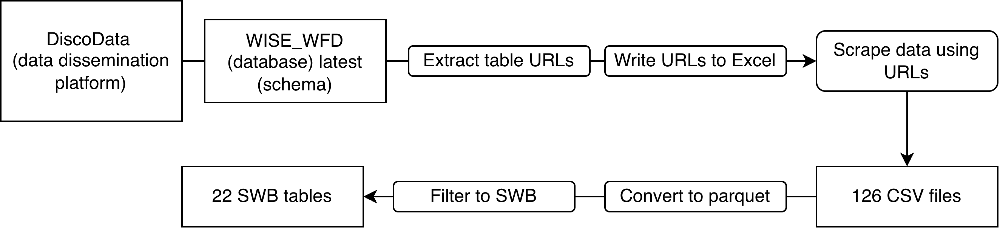

# freshwater-qe-trends

This repository contains all code pertaining to the 2026 thesis titled "Assessing Spatio-temporal Trends for the Quality Element Status of Freshwater-related Environments", by Elizabeth Leshuk.

This repository contains code to 1) scrape WISE WFD data and metadata from [Discodata](https://discodata.eea.europa.eu/) (European Environment Agency), 2) filter, clean, and process the Surface Water Body related tables (Figure 1), 3) model individual biological quality element (BQE) data, 4) plot

This study builds a harmonized, water body-level dataset of Water Framework Directive (WFD) surface water biological quality element (BQE) status for the 2010, 2016, and 2022 reporting cycles. The dataset integrates spatial, climate, land use, nutrient, and reported pressures data, and develops a semi-automated pipeline that can rerun as new reporting cycles are released. Then, looking only at rivers and using mixed-effects ordinal models, it asks:

1.  What are the spatial and temporal patterns in river BQE status across Europe

2.  Which drivers and pressures are associated with BQE status, and how do they differ between BQEs

3.  How much variation in status is attributable to location and national assessment, compared with drivers and pressures?

Fig. 1. Workflow used to acquire surface water body (SWB) data from the Water Information System for Europe - Water Framework Directive (WISE_WFD) database on the European Environment Agency (EEA) Discodata platform.

## Project structure

### R/

-   Contains 1 file to run each of the functions in this folder
-   Contains R functions for:
    -   WFD Data scraping
    -   Data cleaning, filtering, and joining
    -   Processing spatial
    -   Merging in biogeography
    -   Splitting rivers from lakes
    -   Transforming rivers data
    -   Building the driver matrix for modeling

### python/

-   Contains functions for joining CCM2 (De Jager & Vogt, 2007) to WFD water bodies
    -   Polygons are kept if more than 10% of a water body’s total area falls within a catchment, or if the overlap is more than 10,000 m²
    -   Lines are kept if more than 10% of the segment length falls within a catchment (`intersection length / Segment_length > 0.1`)
-   assign_catchments.py

### extract_drivers 

-   Code used to join drivers data with CCM2 (De Jager & Vogt, 2007) catchments
-   These functions are best run on a computer with \> 50GB RAM
    -   For this thesis, the code was run on a desktop computer with an Intel Core i9-10900X processor (10 cores, 20 threads, 3.70 GHz base frequency) and 64 GB of RAM, running Windows 10 Enterprise LTSC 2019 (version 1809, 64-bit) running R 4.3.2.
    -   The large memory requirements were due to the 1.4 million catchments in Europe
        -   Could potentially be made faster by changing the joining method (current method may be unconventional)
-   Contains 1 file to run each of the functions in this folder
-   Contains R functions for extracting external data drivers for:
    -   Climate
        -   Contains
    -   Imperviousness
    -   AMBER barriers
    -   Land cover
    -   Nitrogen surplus
    -   Phosphorus surplus

### Notebooks

-   Contains the original notebook used to join WFD water bodies with CCM2 catchments

## How to run the pipeline

## Data sources:

-   Climate - E-OBS (Cornes et al., 2018)
-   Land cover - CORINE Land Cover (CLMS, 2020)
-   Imperviousness - HRL Imperviousness Density (CLMS, 2020)
-   Nitrogen surplus - Batool et al. (2022)
-   Phosphorus surplus - Batool et al. (2025)
-   AMBER (Belletti et al., 2020)
-   WISE-WFD (European Environmental Agency - Discodata database)
