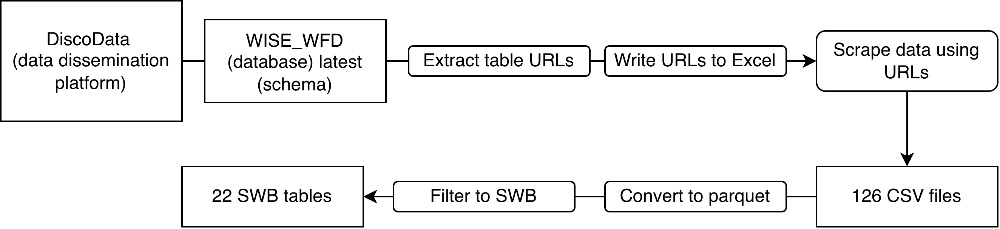

# freshwater-qe-trends

This repository contains all code pertaining to the 2026 thesis titled "Assessing Spatio-temporal Trends for the Quality Element Status of Freshwater-related Environments", by Elizabeth Leshuk.

This repository contains code to 1) scrape WISE WFD data and metadata from [Discodata](https://discodata.eea.europa.eu/) (European Environment Agency), 2) filter, clean, and process the Surface Water Body related tables (Figure 1), 3) model individual biological quality element (BQE) data, 4) plot

This study builds a harmonized, water body-level dataset of Water Framework Directive (WFD) surface water biological quality element (BQE) status for the 2010, 2016, and 2022 reporting cycles. The dataset integrates spatial, climate, land use, nutrient, and reported pressures data, and develops a semi-automated pipeline that can rerun as new reporting cycles are released. Then, looking only at rivers and using mixed-effects ordinal models, it asks:

1.  What are the spatial and temporal patterns in river BQE status across Europe?

2.  Which drivers and pressures are associated with BQE status, and how do they differ between BQEs?

3.  How much variation in status is attributable to location and national assessment, compared with drivers and pressures?

Fig. 1. Workflow used to acquire surface water body (SWB) data from the Water Information System for Europe - Water Framework Directive (WISE_WFD) database on the European Environment Agency (EEA) Discodata platform.

## How to run the pipeline

### Requirements

-   R 4.3 or newer, with the packages installed by `install_packages.R`; Python 3.12 with the packages in `requirements.txt` (only for 0102 and the maps)
-   Pipeline 02 (driver extraction) needs a machine with about 64 GB of RAM and takes hours; `extract_drivers/0202b_extract_climate_batched.R` runs the climate extraction on a 16 GB machine (about 7 minutes per variable and statistic on a MacBook Pro)
-   Step 0303 needs well over 16 GB of RAM when it rebuilds the climate driver cache; with the cache in `data/driver_cache/` it runs on a 16 GB laptop
-   Pipeline 05 takes about 45 minutes for the five models on a MacBook Air; the other pipelines take minutes
-   Rerunning with newer package versions (for example `ordinal`, `sf`, `terra` or `exactextractr`) can change results slightly

### Running

Set the working directory to the repository root (for example by creating an RStudio project in the repository folder). The first time, run `install_packages.R` to install the R packages, and `pip install -r requirements.txt` for the two Python scripts. Then run the eight runner scripts in order. Every path is relative to the project root and all data inputs and outputs live in `data/`.

| Runner                      | Steps                                                                                                                                                                                                                                        | Main outputs                                                                                                                      |
|-----------------------------|----------------------------------------------------------------------------------------------------------------------------------------------------------------------------------------------------------------------------------------------|-----------------------------------------------------------------------------------------------------------------------------------|
| `run_00_scrape_clean.R`     | 0001 scrape metadata, 0002 scrape WFD data to parquet, 0003 strip shared columns, 0004 clean, 0005 join BQEs to reference, 0006 filter reference                                                                                             | `data/WFD/parquet_tables_cleaned/`, `data/WFD/parquet_tables_joined/joined_bqe_ref_w2010_final.parquet`, `swb_reference_filtered` |
| `run_01_spatial.R`          | 0100 split the WFD spatial GeoPackages into per-cycle GeoParquet, 0101 remove coastal waters from `Input_data.gpkg`, then 0102 `python python/0102_assign_catchments.py` (run manually)                                                      | `data/WFD/parquet_tables_spatial/`, `data/spatial/ccm2_wfd_join/Input_data_filtered.gpkg`, `data/spatial/Workflow_outputs.gpkg`   |
| `run_02_extract_drivers.R`  | 0201 climate preprocessing (`climate_method` = "cdo" or "windows"), 0202-0207 climate, nitrogen, phosphorus, land cover, imperviousness and AMBER per catchment                                                                              | `data/drivers/<driver>/outputs/`                                                                                                  |
| `run_03_joins.R`            | 0301 BQE spatial join per cycle, 0302 drop geometry, 0303 driver matrix, 0103 water body drainage areas, 0304 biogeographical regions, 0305 river basins                                                                                     | `data/model/model_ready.parquet`, `model_ready_biogeo.parquet`, `model_ready_biogeo_rb.parquet`                                   |
| `run_04_model_prep.R`       | 0401 split lakes and rivers, 0402 transform river covariates, 0403 covariate checks (Fig. S3-S5)                                                                                                                                             | `data/model/rivers_model_df_transformed.parquet`, `plots/covariate_checks/`                                                       |
| `run_05_model.R`            | 0501 fit the five river BQE CLMMs (about 45 min on a MacBook Air; existing fits are skipped)                                                                                                                                                 | `data/model/M4/m4_stage1_results_rivers/RW/`                                                                                      |
| `run_06_model_assessment.R` | 0601 AIC, kappa and observed vs predicted (Tables S5-S6, Fig. S7), 0602 parallel slopes (Table S7), 0603 random-effect QQ (Fig. S6)                                                                                                          | `plots/model_assessment/`, tables in the results folder                                                                           |
| `run_07_figures.R`          | 0701 coefficients (Fig. 10, Table S8), 0702 status by cycle and region (Fig. 7, 8, 9, 12), 0703 variance partitioning (Fig. 11, Table S9), 0704 data for the exploration maps, then `python python/0704_plot_bqe_maps.py` (Fig. 4, 5, 6, S8) | `plots/model_results/`, `plots/maps/`, `data/model/M4/m4_stage1_results_rivers/RW/tables/`                                        |

After the pipelines, `tests/check_pipeline_outputs.R` checks the saved outputs. Table 7 (water bodies after each filtering step) and the Fig. S1/S2 column-presence tables are written to `data/summary_tables/` by pipelines 03 and 00.

### Inputs that are not created by the pipelines

-   `data/WFD/WFD_URLs.xlsx`: Discodata download links (only needed when `scrape <- TRUE`)
-   `data/WFD/spatial_data/`: the three WISE WFD reference spatial GeoPackages (`4326_250_k_wise-wfd{year}_p_*.gpkg`), split per cycle by step 0100
-   `data/spatial/ccm2_wfd_join/Input_data.gpkg`: WFD water bodies with the CCM2 catchments and network, built in ArcGIS (no script). Step 0102 needs these layers and fields: `SurfaceWaterBody` (`WB_code`, `Full_area`), `SurfaceWaterBodyLine` (`WB_code`, `Full_length`), `EU_primary_catchments` (`WSO1_ID`, `Segment_length`, `PC_area`) and the table `Network_data` (`WSO1_ID`, `nextdownWSO1_ID`, `Source_ID`, `dist_mouth`)
-   `data/spatial/CCM2_stuff.gdb`: CCM2 catchments and basins
-   `data/biogeographical_regions/BiogeoRegions2016.shp` (`WB_drainage_areas.gpkg` in the same folder is written by step 0103)
-   Raw driver data in `data/drivers/`: `climate/1995-2010_climate` and `climate/2011-2022_climate` (E-OBS), `nitrogen/`, `phosphorus/`, `land_cover/`, `imperviousness_density/`, `dams/atlas_AMBER.csv`

## Project structure

### R/

Function files, numbered by pipeline and run order (00xx scrape and clean, 01xx spatial (0103 runs in pipeline 03, after the Python step), 03xx joins, 04xx model prep, 05xx model fit, 06xx model assessment, 07xx figures). Each file only defines functions; the `run_*.R` scripts in the project root call them. `0600_model_helpers.R` and `theme_thesis.R` are shared by pipelines 06 and 07.

-   `0003_strip_shared_cols.R` also contains optional QA functions (`check_swb_integrity()`, `check_swb_consistency()`, `check_join_keys()`, `check_assessment()`, `check_grain()`, `check_grain_all()`) that are not run by the pipeline

### python/

-   `0704_plot_bqe_maps.py` draws the exploration maps (Fig. 4, 5, 6, S8). By default it maps the less filtered dataset built in step 0704 (UK, coastal waters, angiosperms and macroalgae kept); `--joined-file` and `--spatial-suffix` choose another version
-   `0102_assign_catchments.py` joins CCM2 (De Jager & Vogt, 2007) to WFD water bodies
    -   Polygons are kept if more than 10% of a water body's total area falls within a catchment, or if the overlap is more than 10,000 m²
    -   Lines are kept if more than 10% of the segment length falls within a catchment (`intersection length / Segment_length > 0.1`)
    -   Input: `data/spatial/ccm2_wfd_join/Input_data_filtered.gpkg` (or `WFD_INPUT_PATH`)
    -   Output: `data/spatial/Workflow_outputs.gpkg`
    -   Interactive by default; for an unattended run set `WFD_EXECUTION_MODE=unattended` and `WFD_RUN_PROFILE=full`

### extract_drivers/

-   Functions to join external driver data with CCM2 (De Jager & Vogt, 2007) catchments, numbered 02xx
-   These functions are best run on a computer with \> 50GB RAM
    -   For this thesis, the code was run on a desktop computer with an Intel Core i9-10900X processor (10 cores, 20 threads, 3.70 GHz base frequency) and 64 GB of RAM, running Windows 10 Enterprise LTSC 2019 (version 1809, 64-bit) running R 4.3.2.
    -   The large memory requirements were due to the 1.4 million catchments in Europe
-   Drivers: climate, nitrogen surplus, phosphorus surplus, land cover, imperviousness, AMBER barriers
-   `0202b_extract_climate_batched.R` gives the same climate outputs as `0202_extract_climate.R` but processes catchments in batches, so it runs on a 16 GB machine; an interrupted run resumes from the last finished batch

### presentation/

-   Code for presentation figures, not part of the thesis pipeline; run `presentation/run_presentation.R` from the project root after pipeline 03. Figures are saved to `plots/presentation/`
-   `theme_presentation.R`: colours, font (Montserrat) and ggplot theme matching the defense slides; source it before the other files
-   `wb_context_maps.R`: `find_basin_wbs()` lists water bodies in a CCM2 basin with a quality element assessed; `plot_wb_context()` maps one water body on its own, in its catchment, in its basin and in Europe
-   `wb_cycle_bars.R`: `plot_wb_cycle_bars()` shows the river water bodies used in the models per cycle (from `data/model/linear_predictors_*.csv`), split by whether each appears in one, two or all three cycles

### plots/

-   Figures written by pipelines 04, 06 and 07

### notebooks/

-   Contains the original notebook used to join WFD water bodies with CCM2 catchments

## Getting the data

`data/` is not included in this repository because of its size (tens of GB). The pipelines expect the inputs below in these locations.

| Data                             | Source                                                                                                                                                                      | Location in `data/`                                                                  |
|----------------------------------|-----------------------------------------------------------------------------------------------------------------------------------------------------------------------------|--------------------------------------------------------------------------------------|
| WISE WFD tables                  | EEA Discodata (EEA, n.d.); downloaded by pipeline 00 with `scrape <- TRUE` from the links in `WFD/WFD_URLs.xlsx`                                                            | `WFD/parquet_tables/`                                                                |
| WISE WFD spatial data            | [WISE WFD reference spatial datasets, public version 1.9](https://www.eea.europa.eu/en/datahub/datahubitem-view/a50d10f6-e0f6-496b-a6e2-27eb5ad204e8) (EEA, 2025)           | `WFD/spatial_data/`, split per cycle into `WFD/parquet_tables_spatial/` by step 0100 |
| CCM2 catchments and river basins | [CCM2](http://data.europa.eu/89h/fe1878e8-7541-4c66-8453-afdae7469221) (De Jager & Vogt, 2007), [river basins](https://doi.org/10.2905/JRC.H24719R) (De Jager & Vogt, 2026) | `spatial/ccm2_wfd_join/Input_data.gpkg`, `spatial/CCM2_stuff.gdb`                    |
| Climate                          | [E-OBS](https://surfobs.climate.copernicus.eu/dataaccess/access_eobs.php) ensemble mean, 0.1° grid, v33.0e for 1995-2010 and v27.0e for 2011-2022 (Cornes et al., 2018)     | `drivers/climate/1995-2010_climate/`, `drivers/climate/2011-2022_climate/`           |
| Land cover                       | CORINE Land Cover 2006, 2012 and 2018, 100 m, version 2020_20u1 (CLMS, 2020a-c)                                                                                             | `drivers/land_cover/`                                                                |
| Imperviousness                   | HRL Imperviousness Density 2009, 2015 and 2018, 100 m (CLMS, 2020d-f)                                                                                                       | `drivers/imperviousness_density/`                                                    |
| Nitrogen surplus                 | [Batool et al. (2022)](https://doi.org/10.5281/zenodo.6581441)                                                                                                              | `drivers/nitrogen/`                                                                  |
| Phosphorus surplus               | [Batool et al. (2025)](https://doi.org/10.5194/essd-17-881-2025)                                                                                                            | `drivers/phosphorus/`                                                                |
| River barriers                   | AMBER atlas (Belletti et al., 2020)                                                                                                                                         | `drivers/dams/atlas_AMBER.csv`                                                       |
| Biogeographical regions          | [Biogeographical regions, Europe 2016](https://www.eea.europa.eu/en/datahub/datahubitem-view/11db8d14-f167-4cd5-9205-95638dfd9618) (EEA, 2016)                              | `biogeographical_regions/`                                                           |

The Discodata tables are updated over time, so a new download may not give the same counts as the thesis.

## References

Batool, M., Sarrazin, F. J., Attinger, S., Basu, N. B., Van Meter, K., & Kumar, R. (2022). Long-term annual soil nitrogen surplus across Europe (1850–2019) (Version 1.0) [Data set]. Zenodo. <https://doi.org/10.5281/zenodo.6581441>

Batool, M., Sarrazin, F. J., & Kumar, R. (2025). Century-long reconstruction of gridded phosphorus surplus across Europe (1850–2019). Earth System Science Data, 17(3), 881–916. <https://doi.org/10.5194/essd-17-881-2025>

Belletti, B., Garcia de Leaniz, C., Jones, J., Bizzi, S., Börger, L., Segura, G., Castelletti, A., van de Bund, W., Aarestrup, K., Barry, J., Belka, K., Berkhuysen, A., Birnie-Gauvin, K., Bussettini, M., Carolli, M., Consuegra, S., Dopico, E., Feierfeil, T., Fernández, S., ... Zalewski, M. (2020). More than one million barriers fragment Europe's rivers. Nature, 588(7838), 436–441. <https://doi.org/10.1038/s41586-020-3005-2>

Copernicus Land Monitoring Service. (2020a). CORINE Land Cover 2006 (raster 100 m), Europe, 6-yearly (Version 2020_20u1) [Data set]. European Environment Agency. <https://doi.org/10.2909/08560441-2fd5-4eb9-bf4c-9ef16725726a>

Copernicus Land Monitoring Service. (2020b). CORINE Land Cover 2012 (raster 100 m), Europe, 6-yearly (Version 2020_20u1) [Data set]. European Environment Agency. <https://doi.org/10.2909/a84ae124-c5c5-4577-8e10-511bfe55cc0d>

Copernicus Land Monitoring Service. (2020c). CORINE Land Cover 2018 (raster 100 m), Europe, 6-yearly (Version 2020_20u1) [Data set]. European Environment Agency. <https://doi.org/10.2909/960998c1-1870-4e82-8051-6485205ebbac>

Copernicus Land Monitoring Service. (2020d). Imperviousness density 2009 (raster 100 m), Europe, 3-yearly [Data set]. European Environment Agency. <https://land.copernicus.eu/en/products/high-resolution-layer-imperviousness/imperviousness-density-2009>

Copernicus Land Monitoring Service. (2020e). Imperviousness density 2015 (raster 100 m), Europe, 3-yearly [Data set]. European Environment Agency. <https://doi.org/10.2909/d6152a22-cc3f-4353-8989-14528c0a713d>

Copernicus Land Monitoring Service. (2020f). Imperviousness density 2018 (raster 100 m), Europe, 3-yearly [Data set]. European Environment Agency. <https://doi.org/10.2909/524fa72f-61d7-4364-801e-3e271d7b10bc>

Cornes, R. C., van der Schrier, G., van den Besselaar, E. J. M., & Jones, P. D. (2018). An ensemble version of the E-OBS temperature and precipitation datasets. Journal of Geophysical Research: Atmospheres, 123(17), 9391–9409. <https://doi.org/10.1029/2017JD028200>

De Jager, A., & Vogt, J. (2007). Rivers and catchments of Europe: Catchment Characterisation Model (CCM) [Data set]. European Commission, Joint Research Centre. <http://data.europa.eu/89h/fe1878e8-7541-4c66-8453-afdae7469221>

De Jager, A., & Vogt, J. (2026). Rivers and catchments of Europe: Catchment Characterisation Model (CCM) [Data set]. European Commission, Joint Research Centre. <https://doi.org/10.2905/JRC.H24719R>

European Environment Agency. (n.d.). Discodata [Database]. <https://discodata.eea.europa.eu/>

European Environment Agency. (2016). Biogeographical regions, Europe 2016 (Version 1) [Data set]. <https://www.eea.europa.eu/en/datahub/datahubitem-view/11db8d14-f167-4cd5-9205-95638dfd9618>

European Environment Agency. (2025). WISE WFD reference spatial datasets reported under Water Framework Directive (Public version 1.9) [Data set]. <https://www.eea.europa.eu/en/datahub/datahubitem-view/a50d10f6-e0f6-496b-a6e2-27eb5ad204e8>
